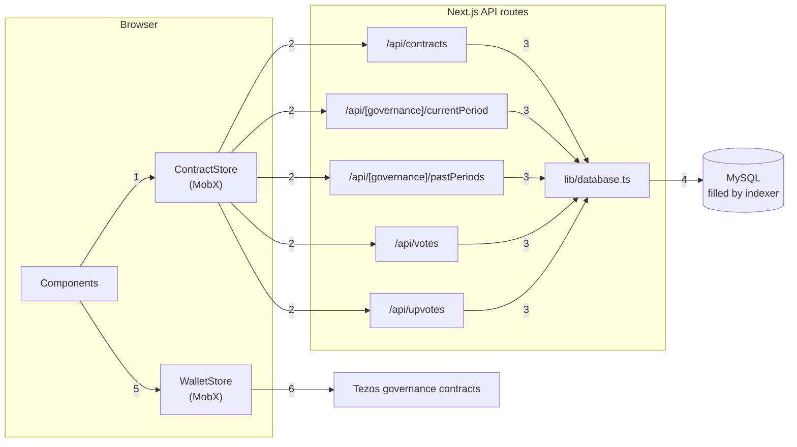

# Etherlink Governance Website

## Overview
A Next.js app for exploring and taking part in Etherlink governance on Tezos. It shows governance contracts, proposals and voting periods, and lets bakers vote and upvote from their wallet.

## Core Features
- **Governance Contracts**: Browse slow, fast and sequencer governance
- **Periods**: Current, past and future periods with proposals and voting stats
- **Voting**: Connect a wallet to submit proposals, upvote and vote
- **Voting Rights**: Claim voting rights and manage voting keys (delegation contract)
- **CLI Commands**: Copy the matching CLI command for votes and upvotes

## Technical Stack
- Next.js, TypeScript, Material-UI, MobX
- Octez.js for wallet connection and contract calls
- PostHog for analytics
- API routes in `src/pages/api/` read governance data straight from the indexer's MySQL database

## Key Pages
- **Home** (`/`): Overview of the governance contracts
- **Governance** (`/governance/[governance]`): Current, past and future periods for one governance type

## Setup & Usage
```sh
cp .env.sample .env     # mainnet (also .env.mainnet.sample, .env.shadownet.sample)
npm run dev             # Start development server
npm run build           # Build for production
npm run start           # Run production server
```

## Environment Variables
- `NEXT_PUBLIC_NETWORK_TYPE`: `mainnet` or `shadownet`
- `NEXT_PUBLIC_RPC_URL`: Tezos RPC node
- `NEXT_PUBLIC_TZKT_API_URL` / `NEXT_PUBLIC_TZKT_URL`: TzKT API and explorer links
- `NEXT_PUBLIC_VOTING_RIGHTS_DELEGATION_CONTRACT`: voting rights delegation contract
- `NEXT_PUBLIC_POSTHOG_KEY` / `NEXT_PUBLIC_POSTHOG_HOST`: PostHog analytics
- `NEXT_PUBLIC_DISPLAY_IN_TEZ`: show amounts in tez
- `DB_HOST`, `DB_PORT`, `DB_USER`, `DB_PASSWORD`, `DB_NAME`: MySQL database filled by the indexer

## Data Flow



1. Components ask `ContractStore` for contracts, periods, votes and upvotes.
2. `ContractStore` calls the matching Next.js API route.
3. Each API route uses `lib/database.ts` to run its query.
4. `lib/database.ts` reads from the MySQL database that the indexer fills.
5. When a user votes, upvotes, proposes or manages voting rights, components call `WalletStore`.
6. `WalletStore` uses Octez.js to have the wallet sign and send the operation straight to the governance contract. It shows on the site once the indexer saves it.
