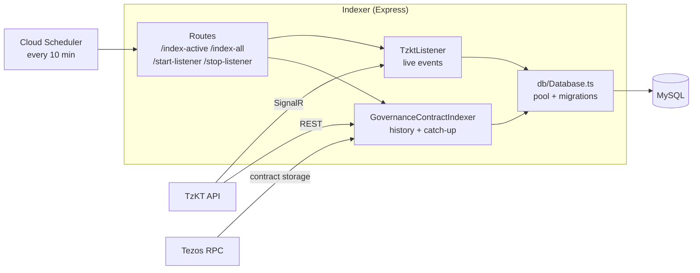

# Etherlink Governance Indexer

## Overview
A Node.js service that indexes Tezos governance data into MySQL. It runs an Express API for triggering indexing, plus a live listener for new blockchain events.

Data is updated two ways: the live listener writes new proposals, upvotes and votes within seconds, and a scheduled `/index-active` call (every 10 min) re-reads the current period from TzKT to fill in anything the listener missed. Writes are upserts, so overlap is safe.

## Core Features
- **Database Management**: MySQL migrations for the governance data schema
- **Real-time Indexing**: SignalR listener for live events from the TzKT API
- **Express API**: Endpoints for triggering indexing
- **Historical Data**: Full governance history indexing with incremental updates

## Technical Stack
- Node.js, TypeScript, Express
- MySQL with automated migrations
- TzKT API and Tezos RPC (Octez.js) for chain data

## Key Components
- **Migrations**: SQL schema in `src/db/migrations/`
- **Contracts**: Governance contracts per network in `src/contracts.ts`
- **Listener**: Live governance event processing (`src/TzktListener.ts`)
- **Contract Indexer**: Historical and incremental sync (`src/GovernanceContractIndexer.ts`)

## API Endpoints
```sh
GET /start-listener     # Start real-time blockchain listener
GET /stop-listener      # Stop the listener
GET /index-active       # Index active governance contracts
GET /index-all          # Index all contracts (active + historical)
```

## Setup & Usage
```sh
cp .env.sample .env     # then fill in DB_* values
npm run dev             # Start development server
npm run build           # Build for production
npm run start           # Build and run production server
```

## Environment Variables
- `NETWORK`: `mainnet` uses mainnet contracts; any other value uses testnet contracts
- `RPC_URL`: Tezos RPC node
- `TZKT_API_URL`: TzKT API
- `DELEGATE_VIEW_CONTRACT`: voting rights delegation contract
- `DB_HOST`, `DB_PORT`, `DB_USER`, `DB_PASSWORD`, `DB_NAME`: MySQL database
- `PORT`: API port (default `8080`)

## Components


