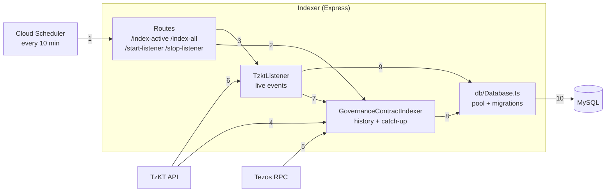

# Etherlink Governance Indexer

## Overview
A Node.js service that indexes Tezos governance data into MySQL. It runs an Express API for triggering indexing, plus a live listener for new blockchain events.

Data is updated two ways: the live listener writes new proposals, upvotes and votes within seconds, and a scheduled `/index-active` call (every 10 min) re-reads the current period from TzKT to fill in anything the listener missed. Writes are upserts, so overlap is safe.

## Core Features
- **Database Management**: MySQL migrations for the governance data schema
- **Real-time Indexing**: SignalR listener for live events from the TzKT API
- **Express API**: Endpoints for triggering indexing
- **Historical Data**: Full governance history indexing with incremental updates

## Technical Stack
- Node.js, TypeScript, Express
- MySQL with automated migrations
- TzKT API and Tezos RPC (Octez.js) for chain data

## Key Components
- **Migrations**: SQL schema in `src/db/migrations/`
- **Contracts**: Governance contracts per network in `src/contracts.ts`
- **Listener**: Live governance event processing (`src/TzktListener.ts`)
- **Contract Indexer**: Historical and incremental sync (`src/GovernanceContractIndexer.ts`)

## API Endpoints
```sh
GET /start-listener     # Start real-time blockchain listener
GET /stop-listener      # Stop the listener
GET /index-active       # Index active governance contracts
GET /index-all          # Index all contracts (active + historical)
```

## Setup & Usage
```sh
cp .env.sample .env     # then fill in DB_* values
npm run dev             # Start development server
npm run build           # Build for production
npm run start           # Build and run production server
```

## Environment Variables
- `NETWORK`: `mainnet` uses mainnet contracts; any other value uses testnet contracts
- `RPC_URL`: Tezos RPC node
- `TZKT_API_URL`: TzKT API
- `DELEGATE_VIEW_CONTRACT`: voting rights delegation contract
- `DB_HOST`, `DB_PORT`, `DB_USER`, `DB_PASSWORD`, `DB_NAME`: MySQL database
- `PORT`: API port (default `8080`)

## Data Sources

| Source | What the indexer gets |
|---|---|
| **Contract storage** (read via TzKT `/contracts/{address}/storage`) | Contract settings (start level, period length, quorums, upvote limit); period index at a level; winning proposal hash for promotion periods |
| **TzKT API** | Contract transactions (proposals, upvotes, votes); block dates and levels; Tezos voting periods; baker voting power and alias; live events over SignalR |
| **Tezos RPC** (`RPC_URL`) | Total voting power at a level; `get_voting_state` view on the governance contract (is this a promotion period?); `list_voters` view on the delegation contract (`DELEGATE_VIEW_CONTRACT`) to find who a voting key votes for |

## Components



1. Cloud Scheduler calls the indexer's routes every 10 minutes.
2. `/index-active` (or `/index-all`) runs `GovernanceContractIndexer` to catch up on history.
3. `/start-listener` starts `TzktListener` if it isn't already running.
4. The indexer reads from TzKT over REST:
   - Contract storage: settings (start level, period length, quorums, upvote limit)
   - Contract storage: period index at a given level
   - Contract storage: winning proposal hash for promotion periods
   - Contract transactions (proposals, upvotes, votes)
   - Block dates and levels
   - Tezos voting periods
   - Baker voting power and alias
5. The indexer reads from the Tezos RPC:
   - Total voting power at a level
   - `get_voting_state` view on the governance contract (is this a promotion period?)
   - `list_voters` view on the delegation contract (who a voting key votes for)
6. TzKT pushes new blocks and contract transactions to the listener over SignalR.
7. The listener reuses the indexer's lookups (voting power, voters, period index) to build each record.
8. The indexer saves periods, proposals, promotions, upvotes and votes.
9. The listener saves new proposals, upvotes and votes, and updates periods when a new one starts.
10. `Database.ts` writes to MySQL as upserts, so running both paths is safe.
